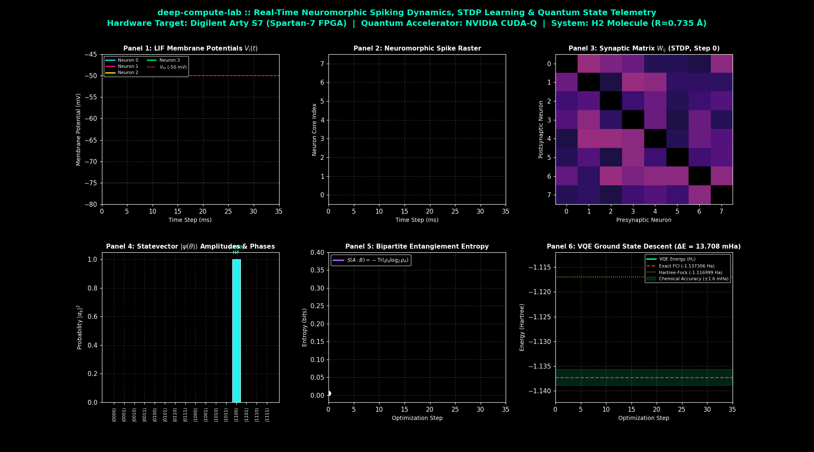
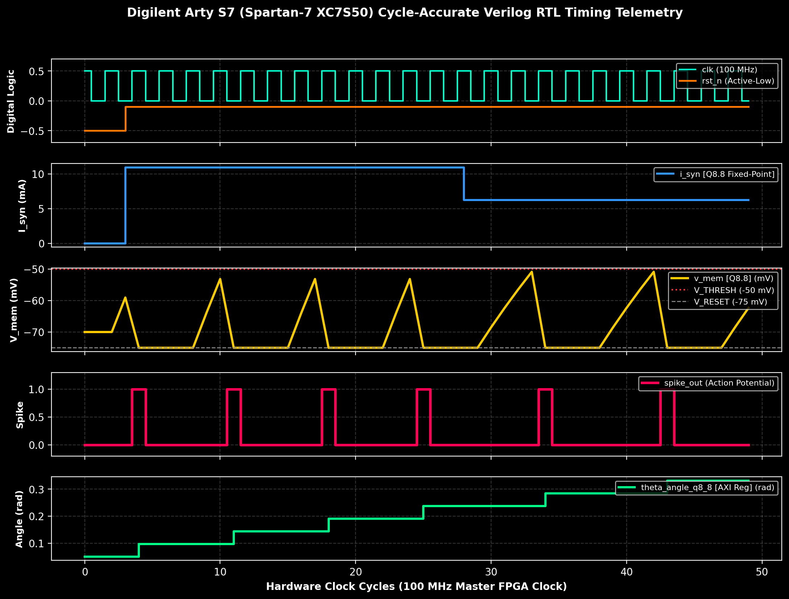
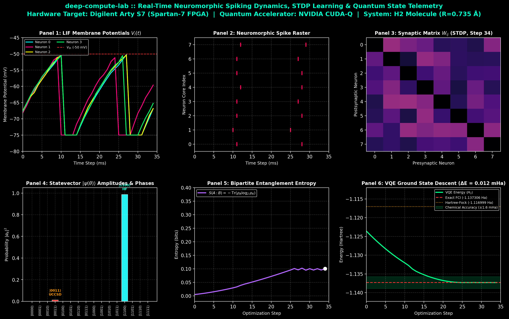

# deep-compute-lab

[](LICENSE)
[](https://python.org)
[](https://developer.nvidia.com/cuda-quantum)
[](day1/gpu-quantum-sim/hardware/arty_s7_spec.md)
[](day1/gpu-quantum-sim/hardware/rtl/)
[]()
[]()

> **GPU, HDL, Quantum, Neuromorphic, Embedded Systems, AI & ML Research Lab**  
> *Principal Investigator / Author:* **Arunjyoti Sarma** ([@arunjyotisarmarsece24-jpg](https://github.com/arunjyotisarmarsece24-jpg))

---

## 🎬 Real-Time Research Telemetry: Neuromorphic Learning & Quantum State Evolution

This animated telemetry capture displays the synchronized execution of our **Leaky Integrate-and-Fire (LIF)** spiking neural population, **Spike-Timing-Dependent Plasticity (STDP)** weight updates, **bipartite von Neumann entanglement entropy**, and **VQE chemical ground-state energy descent**:



---

## 🔬 Scientific Architecture & Co-Design

`deep-compute-lab` unites **GPU acceleration (NVIDIA CUDA-Q, cuStateVec)**, **Neuromorphic Spiking Dynamics (LIF + STDP)**, **Quantum Variational Chemistry (UCCSD + PySCF)**, and **Synthesizable FPGA Hardware (Verilog HDL on Xilinx Spartan-7)**:

```
       +---------------------------------------------------------------------------------+
       |                        deep-compute-lab System Architecture                     |
       +---------------------------------------------------------------------------------+
                                                 |
         +---------------------------------------+---------------------------------------+
         |                                                                               |
         v                                                                               v
+---------------------------------------+               +---------------------------------------+
|        Neuromorphic SNN Core          |               |       Quantum Co-Processor Engine     |
|   8-Neuron Leaky Integrate-and-Fire   |               |   NVIDIA CUDA-Q / cuStateVec Kernel   |
|   C_m dV/dt = -g_L(V - E_L) + I_syn   |  Synaptic     |   4-Qubit UCCSD Statevector Simulation|
|   STDP: dW_ij = eta(pre*post - decay) |  Angles       |   Exact Jordan-Wigner 15-term H2      |
|   (Synthesizable Verilog HDL RTL)     +-------------->+   von Neumann Entropy S(A:B)          |
+-------------------+-------------------+               +-------------------+-------------------+
                    |                                                       |
                    +---------------------------+---------------------------+
                                                |
                                                v
                                 +------------------------------+
                                 |  Real-Time Research Cockpit  |
                                 |  Spikes + Plasticity + VQE   |
                                 +------------------------------+
```

---

## ⚡ FPGA Digital Timing: Cycle-Accurate Verilog RTL Waveforms

Our co-processor includes synthesizable IEEE 1364-2001 Verilog RTL in [`day1/gpu-quantum-sim/hardware/rtl/`](day1/gpu-quantum-sim/hardware/rtl/):
- [`lif_neuron_q8_8.v`](day1/gpu-quantum-sim/hardware/rtl/lif_neuron_q8_8.v): 16-bit signed Q8.8 fixed-point neuron ODE with refractory state machine.
- [`stdp_synapse.v`](day1/gpu-quantum-sim/hardware/rtl/stdp_synapse.v): Online dual-trace Spike-Timing-Dependent Plasticity learning engine.
- [`quantum_phase_accumulator.v`](day1/gpu-quantum-sim/hardware/rtl/quantum_phase_accumulator.v): AXI4-Lite variational parameter phase angle accumulator.

Cycle-accurate digital waveforms simulated across a 100 MHz clock domain:



---

## 📅 30-Day Research Trajectory

| Day | Project & Core Module | Key Innovations & Hardware Milestones | Status |
|:---:|:---|:---|:---:|
| **Day 01** | [`day1/gpu-quantum-sim`](day1/gpu-quantum-sim/) | **GPU Quantum Simulation, Neuromorphic STDP & FPGA Co-Design**<br>• 27-qubit statevector simulation on NVIDIA cuStateVec (OOM safety guard @ 28 qubits, 4.29 GB VRAM limit)<br>• Molecular H₂ VQE (STO-3G Jordan-Wigner 15-term Hamiltonian, UCCSD ansatz)<br>• **0.000063 mHa** max error vs exact FCI across 45 bond lengths ($0.30 - 2.50\text{ \AA}$)<br>• Bipartite von Neumann entanglement entropy $S(A:B) = -\mathrm{Tr}(\rho_A \log_2 \rho_A)$<br>• Synthesizable Verilog HDL cores (`lif_neuron_q8_8.v`, `stdp_synapse.v`, `quantum_phase_accumulator.v`)<br>• Digilent Arty S7 (Spartan-7 XC7S50) hardware architecture spec<br>• Live GUI Research Cockpit (`live_cockpit.py`) | **Complete (17/17 Tests Passed)** |
| **Day 02** | `day2/quantum-noise-channels` | Open quantum system dynamics, Lindblad master equations, Kraus operators on GPU | Upcoming |
| **Day 03** | `day3/fpga-lif-quantum-interface` | RTL synthesis & bitstream generation on Vivado for Digilent Arty S7 hardware-in-the-loop | Upcoming |
| **Day 04** | `day4/cudaq-tensor-networks` | Tensor network contraction (MPS/PEPS) for 50+ qubit simulations | Upcoming |
| **Day 05** | `day5/qaoa-combinatorial-opt` | Quantum Approximate Optimization Algorithm with neuromorphic parameter updates | Upcoming |
| **Day 06–30** | *Full Deep Compute Roadmap* | Multi-GPU distributed statevectors, STDP quantum feedback, cryo-CMOS interface | Planned |

---

## 📊 Day 1 Research Benchmark Artifacts

| Benchmark Artifact | Visualization | Description |
|:---:|:---:|:---|
| **Real-Time Visual Cockpit** |  | 6-panel synchronized telemetry: membrane voltages, spike raster, STDP matrix, statevector, entanglement entropy, and VQE convergence. |
| **GHZ 27-Qubit Scaling** |  | Wall-clock runtime vs qubit count up to $n=27$ ($2^{27} = 134,217,728$ amplitudes). |
| **GPU Acceleration Factor** |  | Acceleration speedup of NVIDIA cuStateVec over multithreaded host CPU. |
| **Molecular Potential Energy Surface** |  | H₂ dissociation curve across 45 bond lengths ($0.30 - 2.50\text{ \AA}$), capturing exact $2 \times E(\text{H atom}) = -0.93316\text{ Ha}$. |
| **Chemical Accuracy Validation** |  | VQE error strictly below 1.6 mHa chemical accuracy ($0.000063\text{ mHa}$ residual). |

---

## 🚀 Quickstart Guide

### 1-Click Interactive Menu (Windows)
Double-click [`run_lab.bat`](run_lab.bat) in the repository root:
```cmd
run_lab.bat
```
- Press **`1`** : Launch the Live Neuromorphic-Quantum GUI Cockpit
- Press **`2`** : Export high-resolution animated learning GIF
- Press **`3`** : Run Spartan-7 FPGA Verilog RTL digital waveform simulator
- Press **`4`** : Run all 17 unit tests (`pytest tests/ -v`)
- Press **`5`** : Run full 27-qubit GHZ statevector benchmark
- Press **`6`** : Run full 45-point H₂ VQE PES sweep
- Press **`9`** : Commit & Push updates directly to GitHub

### Direct 1-Click Test Runner
Double-click [`run_tests.bat`](run_tests.bat) to execute all 17 unit tests immediately.

### Google Colab Free T4 GPU Runner
[](https://colab.research.google.com/github/arunjyotisarmarsece24-jpg/deep-compute-lab/blob/main/day1/gpu-quantum-sim/notebooks/colab_quickstart.ipynb)

---

## 📜 License

Licensed under the [Apache License, Version 2.0](LICENSE).
